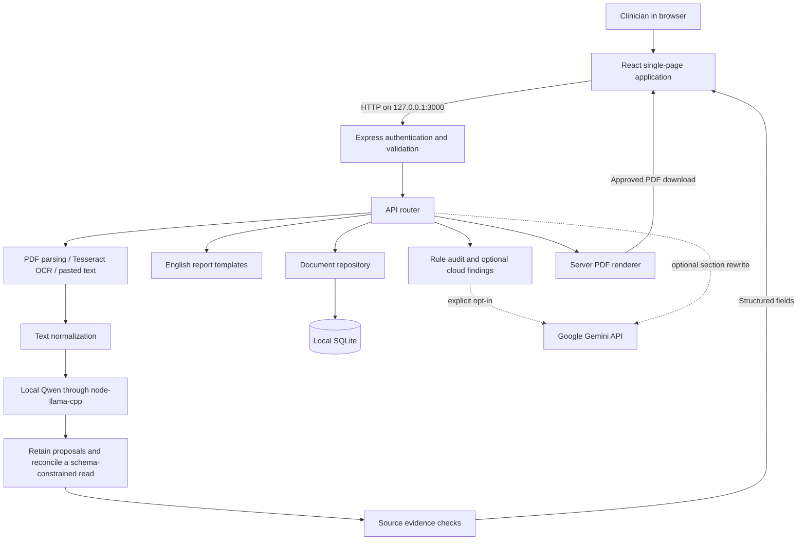
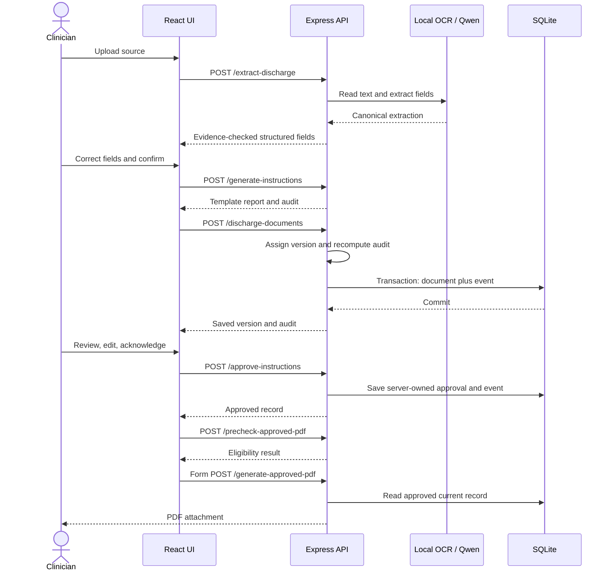

# Current system design

Source baseline: commit `374b2d4`, inspected and remediated in the uncommitted working tree on 20 October 2026. This describes the implemented application, rather than a proposed hospital-wide platform. Configuration observations refer to the local `.env` inspected on that date, not a guarantee about future settings or shell overrides. See the current [findings](audit/architecture-security-review.md), [API](api.md), [evaluation](clinical-evaluation.md) and [final verification](audit/final-verification-report.md).

## 1. Purpose and scope

The Healthcare Discharge Instructions Generator is a local, single-clinician web application. It turns an existing discharge document into structured clinical fields, requires clinician verification, builds an English instruction report, runs limited automated checks, records approval, and downloads an approved PDF.

It does not train a model, retrieve from a vector database, integrate with an EHR, or independently decide a patient's treatment. The local model performs extraction; the initial English report is assembled by templates.

## 2. API and network use

| Connection | Implementation | Required in the main workflow? |
| --- | --- | --- |
| Browser to local backend | Same-origin HTTP REST under `/api` | Yes |
| Backend to local Qwen | `node-llama-cpp` native library in the server process | Yes for extraction; no external AI API |
| Backend to Google Gemini | `@google/genai` | Optional audit and section rewrite |
| Model download | Pinned official Qwen GGUF from Hugging Face, SHA-256 verified | Setup/recovery |
| OCR/native assets and npm dependencies | Package/runtime asset downloads | Setup or first use may need the network |

The local `.env` currently sets `CLOUD_PROCESSING_ENABLED`, `GEMINI_AUDIT_ENABLED`, and `GEMINI_GENERATION_ENABLED` to false. Secret configuration values are excluded from this document. A key alone does not enable cloud processing. This inspection does not constitute a network traffic capture.

For cloud audit, cloud processing, a model identifier, credentials, and the audit flag must be enabled. For section rewriting, the same configuration is needed with the generation flag. Enabling generation does not change the current English initial-generation path: that path still selects local templates. Optional cloud calls send verified clinical fields and report/section text to Google. There is no cloud extraction fallback.

## 3. High-level architecture



The deployment is a modular monolith: one Node server coordinates these modules. Tesseract uses a worker and native inference may use CPU/GPU threads, but there is no separately deployed inference service, message broker, or distributed worker queue.

The same Express server serves the UI and API. In development, Vite runs as middleware; in production, Express serves the built frontend from `dist`. The port defaults to 3000 and the bind address is IPv4 loopback, `127.0.0.1`.

## 4. End-to-end workflow

1. **Launch and sign in.** `start.bat` invokes `scripts/app.ps1`, starts the shared server in the background, polls public `/api/health`, and opens the configured URL. HTTP readiness does not mean model readiness. The browser uses HTTP Basic authentication.
2. **Upload or paste.** The UI submits one PDF/PNG/JPEG file or pasted text to `/api/extract-discharge`. Multer holds the file in memory; the server validates file signature against MIME type.
3. **Read the source.** Digital PDFs use `pdf-parse`. PDFs with insufficient digital text are rendered to page images and processed with Tesseract. Image uploads use Tesseract directly. Pasted text bypasses OCR.
4. **Normalize and extract.** Normalization preserves a copy of the original extracted text. Local Qwen receives the normalized text and a structured extraction prompt. An original-format local proposal read and a schema-constrained local read use reset chat histories. Their canonical fields are reconciled conservatively; unmatched proposals and conflicts remain reviewable. Explicit model uncertainty is retained.
5. **Check evidence.** A normalized source quote must occur in the source, and the field value must occur inside that quote. Unsupported values become `UNCLEAR`. This checks textual support, not full clinical correctness.
   Existing UNCLEAR and missing/invalid model certainty are never inferred FOUND automatically. Medication clauses, recognized source meta-instructions and conflicting allergy statements receive conservative checks. These rules cannot recover omitted facts and can increase manual review for wrapped text.
6. **Clinician verifies.** The clinician edits the fields, resolves/removes unclear entries, and confirms the source data. Server validation requires patient name/ID and binds verifier identity to the authenticated account.
7. **Generate.** Local templates build eight English report sections. The generate endpoint also calculates an audit, but this response alone is not a saved record.
8. **Save and audit.** The UI saves verified data, report, and hospital information. The server assigns the document/report identifiers and version, reruns the audit, clears any previous approval, and commits the document plus an event snapshot.
9. **Review and revise.** Report edits are saved using `If-Match` with the current version. A successful save increments the version and recomputes the audit. Stale updates return 409.
10. **Approve.** The clinician submits the saved document ID, current version, explicit review acknowledgment, and optional signature note. Critical audit findings or an unavailable requested cloud audit block approval.
11. **Download.** The browser prechecks the saved ID and then submits a native form POST for the PDF. The backend reloads and validates the approved record and generates the PDF with jsPDF. The client cannot submit a replacement report or approval inside a PDF request.
    The renderer also checks approval/version eligibility, includes all eight reviewed report sections alongside structured tables, and labels PDF creation time rather than inventing a discharge date. Form submission is reported as requested, not completed.



## 5. Low-level module design

| Module | Responsibility |
| --- | --- |
| `server.ts` | Load configuration, initialize authentication, attach parsers/router, serve Vite or production UI, bind loopback |
| `src/App.tsx` | Navigation, loaded document list, active patient/document, hospital and account display |
| `src/pages/CreateInstructionsPage.tsx` | Six-step wizard state, save/edit calls, report/audit synchronization |
| `src/components/wizard/Step1Upload.tsx` through `Step6Approve.tsx` | Upload, verify, generate, audit, review, approve/download views |
| `server/routes/api.ts` | HTTP contracts, upload guards, extraction admission, save serialization, approval/PDF gates |
| `server/security.ts` | Credentials, Basic authentication, local host/origin checks, headers, rate limits |
| `server/validation.ts` | Runtime input checks and trusted reconstruction of verified data/report/hospital objects |
| `server/services/documentSourceService.ts` | Digital PDF text, scanned PDF rendering, Tesseract and OCR quality metrics |
| `server/services/textNormalizationService.ts` | Normalize whitespace/control characters while retaining original extracted text |
| `server/services/localClinicalExtractionService.ts` | Model checksum/init/cache, inference admission, prompts, context budget, parsing and normalization |
| `server/services/reconcileExtraction.ts` | Preserve unmatched proposals, retain explicit uncertainty and reconcile compatible structured fields |
| `server/services/sourceEvidenceValidator.ts` | Compare values and evidence with the original extracted text |
| `server/services/clinicalExtractionService.ts` | Canonical extraction types and mapping to UI field structures |
| `server/ai/geminiService.ts` | Local English templates plus explicitly enabled Gemini operations |
| `server/audit/deterministicAudit.ts` | Pattern-based comparisons against clinician-verified fields |
| `server/audit/semanticAudit.ts` | Additional local meaning-reversal patterns and optional Gemini findings |
| `server/audit/hybridAudit.ts` | Merge findings, category coverage, severity, overall status and recommendation |
| `server/repositories/documentRepository.ts` | SQLite schema, transactions, optimistic version checks, document/settings access and derived patients |
| `server/services/serverPdfGenerator.ts` | Render approved saved record, pagination, headers/footers and PDF binary checks |
| `server/scripts/download-model.ts` | Download pinned weights, verify checksum and publish atomically |
| `server/scripts/maintenance.ts` | Backup and restore checks |
| `scripts/app.ps1` | Managed start/stop, lifecycle lock, PID/start-time ownership, logs, readiness and browser opening |

React uses component state and props; there is no Redux store or browser-side database. The six navigation pages are Dashboard, Patients, Create Instructions, Review Queue, Documents History, and Settings. Saved records persist on the server; unsaved wizard changes remain in browser memory.

## 6. Domain objects

```text
Canonical extraction
  patient, diagnoses, procedures, medications, allergies, care instructions,
  follow-up appointments, warning signs, emergency instructions
  Each extracted subfield: value + status + source evidence
        |
        v
StructuredDischargeInfo
  Field statuses: FOUND | MISSING | UNCLEAR
        |
        v
AuthoritativeDischargeData
  Structured fields + confirmation + server-assigned verifier/time
        |
        v
GeneratedReport
  ID, version, language, patient identifiers, title, timestamp
  Eight sections: summary; diagnoses/procedures; medications; diet/activity;
  wound care; follow-up; warning/emergency; additional instructions
        |
        v
DischargeDocument
  ID, patient identifiers, verifiedData, generatedReport, currentVersion,
  auditResult, reportHistory, auditHistory, approvalStatus, approvedBy,
  hospitalInfo, createdAt, updatedAt
```

Audit findings include category, severity, status, source/report text, explanation, and whether the check is deterministic. The audit identifies the report version it evaluated.

Although shared TypeScript types retain Hindi/Tamil and additional lifecycle statuses, the current API accepts English reports only. Actual report saves assign `AUDITED` or `NEEDS_REVIEW`; approval assigns `APPROVED`. Wizard progress is not a complete persisted state machine.

## 7. Persistence design

Default database: `data/discharge.sqlite`, configurable through `DATA_PATH`. The app uses Node's synchronous SQLite API with WAL journaling and a 5-second busy timeout. Schema version is 1.

```sql
documents(id TEXT PRIMARY KEY, data TEXT NOT NULL)
settings(id INTEGER PRIMARY KEY CHECK(id=1), data TEXT NOT NULL)
events(id INTEGER PRIMARY KEY, document_id TEXT NOT NULL,
       action TEXT NOT NULL, at TEXT NOT NULL, data TEXT NOT NULL)
```

`data` columns contain JSON. This is document-oriented storage inside SQLite, not separate normalized tables for patients, drugs, reports, or appointments. The patient index is calculated by grouping saved documents by patient ID; `/api/patients` is not an external patient registry.

Document writes use `BEGIN IMMEDIATE`, check the expected current version, upsert the JSON, insert a `created`, `updated`, or `approved` event, then commit. Errors roll back both writes. Events store document snapshots without the embedded history arrays; database triggers reject event UPDATE and DELETE operations through normal SQL.

The route's per-document in-flight set reduces overlapping saves inside the process, while the repository's transaction/version comparison protects the persistence boundary. `If-Match` is the request contract for edits.

Original uploads and full OCR source text are not archived as a durable source-document repository. Verified clinical values, saved reports, audits, approval metadata, and history are persisted. Evidence/provenance is not a full immutable source archive: server validation reconstructs verified fields and does not retain every extraction-time metadata field.

Backups use `VACUUM INTO` for a consistent snapshot. Restore validates integrity/schema and refuses an existing destination or active WAL database. No automatic retention purge is implemented.

## 8. HTTP interface

All paths below have prefix `/api`. All require authentication except health. The application uses JSON for most requests, multipart for upload, and a URL-encoded native form for the final PDF download.

| Method | Path | Contract/purpose |
| --- | --- | --- |
| GET | `/health` | Public HTTP readiness |
| GET | `/session` | Server-owned clinician identity |
| GET | `/extraction-status` | Model presence/load/backend status |
| GET | `/ai-status` | Optional cloud connectivity probe; can call Gemini when enabled |
| GET / PUT | `/settings` | Read settings; update hospital name/department |
| GET | `/patients` | Derived patient index |
| POST | `/extract-discharge` | One multipart `file` or `textInput` |
| POST | `/generate-instructions` | Confirmed `verifiedData`, English generation |
| POST | `/audit-instructions`, `/validate-instructions` | Non-persistent audit of verified data/report |
| POST | `/regenerate-section` | Optional cloud rewrite of a valid section key |
| GET / POST | `/discharge-documents` | List or create saved documents |
| GET / PUT | `/discharge-documents/:id` | Read or edit; PUT needs `If-Match` |
| POST | `/approve-instructions`, `/approve-document` | Saved ID, numeric version, explicit review confirmation, optional note |
| POST | `/precheck-approved-pdf` | Saved ID only, JSON eligibility result |
| POST | `/generate-approved-pdf` | Saved ID only, PDF attachment |

`/documents` and `/documents/:id` remain collection/item aliases. There is no document delete endpoint, streaming inference API, WebSocket business protocol, or job-status queue API. Errors distinguish validation/authentication failures, stale versions (409), extraction busy/rate limits (429), upload limits (413), unsupported media (415), and processing errors.

## 9. AI execution and resource limits

The model is Qwen2.5-1.5B-Instruct, Q4_K_M GGUF, roughly 1.12 GB on disk. The downloader pins an official repository revision and SHA-256; initialization checks the checksum again. Downloaded weights are excluded from Git.

Model loading is lazy and shared: concurrent initialization requests share one promise, and the loaded weights are cached. Each inference creates/disposes its own context. Backend selection tries the runtime's available GPU backend and falls back to CPU; configured GPU layer offload is 28 when a GPU backend is selected.

| Boundary | Current value |
| --- | --- |
| Uploaded file | 15 MiB, one file |
| PDF | 20 pages |
| Pasted text | 32,000 characters |
| Local-model input | 12,000 extracted characters plus tokenizer check |
| Model context | 8,192 tokens |
| Output allowance | Proposal read: 2,048 tokens; structured read: 4,096 tokens, each inside the 8,192-token context |
| Prompt framing reserve | 256 tokens |
| Extraction temperature | 0.05 |
| Inference deadline | One shared 120-second prompt-stage deadline across both local reads |
| OCR deadline | 30 seconds per recognition call, not a whole-upload deadline |
| JSON/urlencoded body | 1 MB |
| Protected request budget | 300 requests/minute per remote address |
| Clinical array validation | At most 100 items per field |

Extraction is single-flight: an overlapping request is rejected rather than queued. The deadline does not cover every phase such as cold model loading. There is no chunked long-document pipeline; oversized text is rejected rather than silently truncated. The source quality score measures textual noise/structure, not recognition accuracy against a ground truth.

## 10. Audit and approval rules

The UI exposes 18 categories. Local checks cover selected patterns involving identity, diagnosis, procedures, medication, allergies, follow-up, omissions, numbers, dates, diet, activity, and medical meaning. This does not imply comprehensive evaluation of those categories.

Categories not covered by the local checks are marked `NOT_EVALUATED`: wound/procedure care, warning signs, emergency instructions, unsupported claims, contradictions, and wording. Optional cloud findings supplement local results; they do not make the local pattern engine a clinical proof system.

Audit aggregation produces findings, category summaries, overall status, a recommendation, cloud availability, and the report version. A critical result blocks approval. Review-required or not-evaluated categories require clinician attention and acknowledgment; the backend does not require an automated PASS for every category. If a requested cloud audit fails or produces invalid results, approval is blocked until the audit is successfully rerun, for example through a fresh save.

Every saved edit invalidates approval. The server owns version assignment, recomputed audits, authenticated verifier/approver identity, and approval timestamp. PDF eligibility is checked both before download and on the final request, using the saved current record.

Eligibility also requires the saved audit's policyVersion to match the current audit-policy constant. Historical/missing policies require save/re-audit/review; existing records/events are not rewritten. Replayed current-version approvals are idempotent. Long body text and oversized clinical table/box fields flow across pages instead of being placed beyond printable bounds; exhaustive font/metadata visual coverage still requires review.

## 11. Security and operational boundaries

- Loopback-only bind; local host allowlist and origin/cross-site checks; no CORS grant.
- HTTP Basic credentials checked with salted scrypt hashes and timing-safe comparisons. Generated credentials are written to ignored `.runtime` files; the convenience login file contains the actual password and must be kept private.
- Authentication covers the UI and API apart from the health endpoint. This is one configured account, with no role directory, SSO, or tenant isolation.
- Browser requests use local HTTP, without TLS. The design assumes a trusted local machine and is not configured for public/LAN hosting.
- SQLite clinical content and backups are not application-encrypted. OS permissions and disk protection are outside the application.
- Runtime logs contain processing diagnostics; the app avoids logging extracted clinical text, but operational files still need local protection.
- Append-only event triggers protect ordinary application history operations, not against an administrator who can replace the database or alter its schema. Approval is an authenticated acknowledgment, not a cryptographic digital signature.

## 12. Deployment, checks, and scaling limits

`start.bat` uses a hidden Node/tsx server with Vite middleware by default; it does not start two separate frontend/backend ports. A lifecycle file lock prevents concurrent launch operations. PID plus process start time identifies the owned process tree. Duplicate starts reopen the saved URL, and `stop.bat` stops only that managed tree. Stop preserves SQLite data; unsaved browser edits are not recovered automatically.

Production-mode local execution is `npm run build` then `npm start`. Vite builds the UI and esbuild bundles the server with external packages. Node 24 is required. There is no Docker/Kubernetes deployment, load balancer, or public hosting configuration.

Checks include TypeScript, authentication/input/persistence tests, clinical regressions, scorer tests, labelled audit/PDF evaluation, model/OCR tests, service integration, production smoke and Windows lifecycle tests. GitHub Actions is configured for clean install, TypeScript, deterministic/security/clinical/PDF tests, pipeline evaluation, build, production smoke and dependency audit on Ubuntu; hardware/model and Windows lifecycle checks remain separate. The final verification report distinguishes actual local execution from unrun remote CI and human clinical review.

Current capacity is a single workstation and one active extraction. OCR, model inference, JSON-document scans, synchronous database access, and embedded history growth are practical limits. Lists have no server pagination, and patient derivation scans document JSON. There is no distributed lock, shared model worker fleet, centralized telemetry, or multi-user authorization model. These are implemented scope boundaries, not capabilities supplied by the current architecture.

## 13. Source references

The primary implementation references are `server.ts`, `server/routes/api.ts`, `server/security.ts`, `server/validation.ts`, `server/repositories/documentRepository.ts`, `server/services/documentSourceService.ts`, `server/services/localClinicalExtractionService.ts`, `server/services/sourceEvidenceValidator.ts`, `server/ai/geminiService.ts`, `server/audit/*`, `server/services/serverPdfGenerator.ts`, `src/App.tsx`, `src/pages/CreateInstructionsPage.tsx`, `src/types/discharge.ts`, `scripts/app.ps1`, and `.github/workflows/ci.yml`.

Current additions: optional canonical additionalNotes are normalized, evidence-checked and mapped to the existing notes editor/template. Appointment subfield certainty survives editing and server reconstruction. The date editor preserves non-ISO source text. Vite denies private runtime/data/model and database/backup paths; development smoke tests exercise direct, encoded and /@fs paths using synthetic sentinels.

Extraction retains the original local proposals and uses a second node-llama-cpp JSON-schema read to require separate value/status/evidence objects and independent medication/appointment subfields. Reconciliation preserves proposals when the structured read omits or conflicts with them. A syntactically valid schema does not prove clinical truth. Evidence checks and explicit clinician verification still apply; truncated or invalid schema output is rejected. See [the Qwen follow-up](audit/qwen-schema-fix.md).
